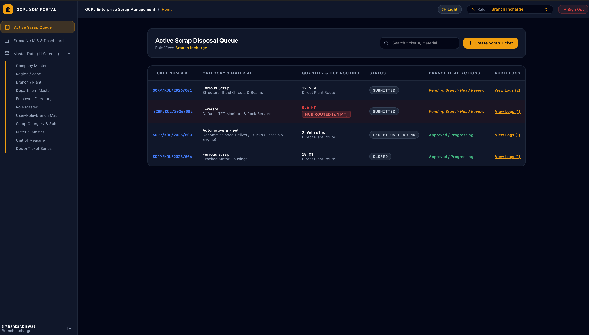
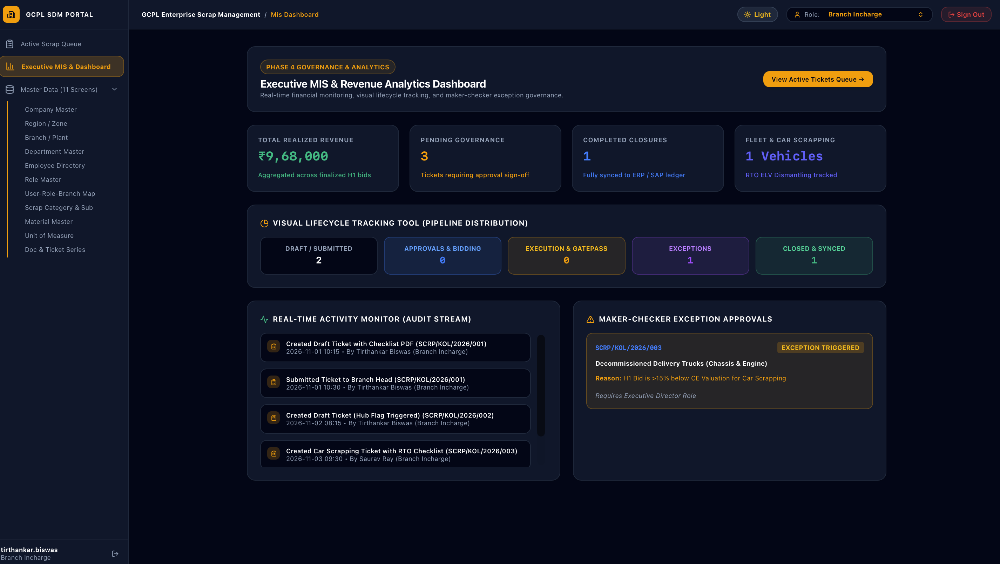
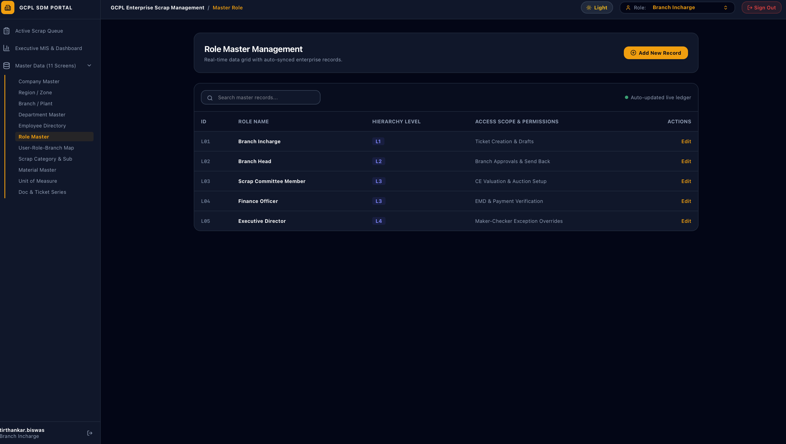

# Scrap Disposal & Asset Management (SDM) System 


An enterprise-grade, secure web portal engineered to digitize and govern the complete corporate asset lifecycle, scrap accumulation ticketing, automated plant hub-routing, multi-tier maker-checker approvals, and SAP financial synchronization.

---

## 🖼️ Application Interface & Preview 

### 1. Secure Authentication & Portal Entry
*ISO 27001 certified gateway with role-based enterprise authentication and built-in Dark/Light theme switching.*
<p align="center">
  
  
</p>

### 2. Active Scrap Disposal Queue (`/home`)
*Real-time ticketing interface with automated $\le 1\text{ MT}$ hub-routing indicators, multi-role action triggers, and inline audit logs.*
<p align="center">
  
</p>

### 3. Executive MIS & Revenue Analytics Dashboard (`/mis-dashboard`)
*Financial telemetry monitoring realized revenue ($\text{₹9,68,000}$), 5-stage pipeline distribution, live action stream tracking, and maker-checker exception approvals.*
<p align="center">
  
</p>

### 4. 11 Reactive Master Data Directory (`/master-data`)
*Centralized administrative configuration management for Companies, Regions, Plants, Departments, Employee Directories, Roles, HSN/GST slabs, UOMs, and Document Series.*
<p align="center">
  
</p>

---

## 🌟 Key Functional Features

* **Automated Hub Routing Logic**: Dynamic system checks automatically flag low-quantity scrap ($\le 1\text{ MT}$) originating from plant facilities without dedicated storage space, re-routing them to regional collection hubs.
* **Specialized Fleet & RTO Dismantling**: Dedicated handling for End-of-Life Vehicle (ELV) commercial fleets with chassis tracking and automated price exception alerts.
* **Maker-Checker Pricing Exception Overrides**: Automated triggers flagging auction bids exceeding $>15\%$ drop below Chartered Engineer (CE) reserve valuations, requiring Executive Director authorization.
* **Real-time Audit Trail Streams**: Comprehensive, immutable activity logging tracking every ticket status change, user handle, role, and action timestamp.

---

## 👥 Role-Based Access Control (RBAC)

| Authorization Level | Role Designation | Operational Responsibilities |
| :--- | :--- | :--- |
| **L1** | **Branch Incharge** | Ticket creation, uploading inspection checklist PDFs, setting UOM/quantities, and submitting requests. |
| **L2** | **Branch Head** | Operational sign-off, branch review, and request modification/send-back capabilities. |
| **L3** | **Scrap Committee & Finance** | Managing CE valuations, reserve price setting, forward auction management, EMD verification, and proforma generation. |
| **L4** | **Executive Director** | High-level maker-checker exception overrides for pricing anomalies and policy compliance sign-offs. |

---

## 🛠️ Tech Stack & Dependencies

* **Frontend Framework**: React (Functional Components & Custom Hooks)
* **Language Support**: TypeScript / JavaScript
* **Iconography**: Lucide React
* **Styling Layer**: Modern Utility CSS / Custom Enterprise UI Theme
* **State Management**: React Component Architecture & Reactive Data Grids

---

## 🚀 Getting Started Locally

### Prerequisites
* **Node.js**: `v18.0.0` or higher installed.

### Installation Steps

1. **Clone the repository**
   ```bash
   git clone [https://github.com/YOUR-USERNAME/jsm_ticketting_tool.git](https://github.com/YOUR-USERNAME/jsm_ticketting_tool.git)
   cd jsm_ticketting_tool